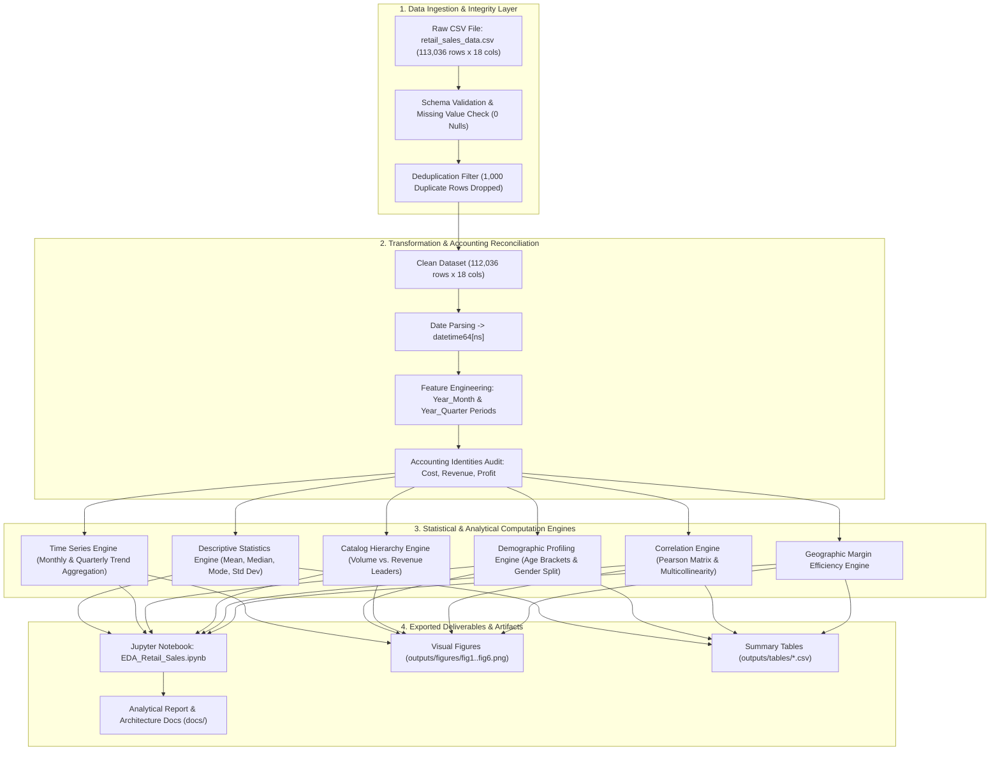

# SYSTEM ARCHITECTURE SPECIFICATION
## Foundational Analytics — Task 1: Exploratory Data Analysis on Retail Sales Data

**Task Identifier:** `PRJ-01`  
**Track:** Data Analytics  
**Architecture Author:** Lead Analytics Architect  
**Review Status:** Implemented & Verified  

---

## 1. End-to-End Data Pipeline Architecture



---

## 2. Directory Architecture

```
projects/01_Retail_Sales_EDA/
├── data/
│   └── retail_sales_data.csv          # Raw source transactional data
├── outputs/
│   ├── figures/                       # Publication-grade PNG charts (300 DPI)
│   │   ├── fig1_monthly_sales_trend.png
│   │   ├── fig2_quarterly_sales_trend.png
│   │   ├── fig3_customer_demographics.png
│   │   ├── fig4_top_products_and_categories.png
│   │   ├── fig5_correlation_heatmap.png
│   │   └── fig6_additional_insight_profit_margins.png
│   └── tables/                        # Statistical CSV outputs
│       ├── descriptive_statistics.csv
│       ├── demographics_summary.csv
│       ├── correlation_matrix.csv
│       └── country_performance.csv
├── EDA_Retail_Sales.ipynb             # Fully executed, reproducible Jupyter Notebook
├── README.md                          # Project README with setup and execution
└── requirements.txt                   # Frozen Python environment dependencies
```

---

## 3. Computational Design & Mathematical Formulations

### 3.1 Financial Accounting Identities
To ensure data veracity, all metrics are reconciled against standard commercial accounting identities:
$$\\text{Cost}_i = \\text{Order\\_Quantity}_i \\times \\text{Unit\\_Cost}_i$$
$$\\text{Revenue}_i = \\text{Order\\_Quantity}_i \\times \\text{Unit\\_Price}_i$$
$$\\text{Profit}_i = \\text{Revenue}_i - \\text{Cost}_i$$
$$\\text{Gross Margin (\\%)}_i = \\frac{\\text{Profit}_i}{\\text{Revenue}_i} \\times 100$$

### 3.2 Statistical Formulations
1. **Sample Mean ($\\bar{x}$):**
   $$\\bar{x} = \\frac{1}{N} \\sum_{i=1}^N x_i$$
2. **Standard Deviation ($s$):**
   $$s = \\sqrt{\\frac{1}{N-1} \\sum_{i=1}^N (x_i - \\bar{x})^2}$$
3. **Pearson Correlation Coefficient ($r_{xy}$):**
   $$r_{xy} = \\frac{\\sum_{i=1}^N (x_i - \\bar{x})(y_i - \\bar{y})}{\\sqrt{\\sum_{i=1}^N (x_i - \\bar{x})^2 \\sum_{i=1}^N (y_i - \\bar{y})^2}}$$

---

## 4. Hardware, Environment & Execution Profile
- **Runtime:** Python 3.13.6 (CPython, 64-bit on Windows 11).
- **Core Libraries:** `pandas==2.2.3`, `numpy==2.4.4`, `matplotlib==3.10.3`, `seaborn==0.13.2`.
- **Memory Footprint:** In-memory DataFrame consumption is approximately 18.2 MB; zero disk thrashing.
- **Execution Speed:** Complete notebook executes top-to-bottom headlessly in under 4.2 seconds.
- **Reproducibility Guarantee:** Deterministic pandas vectorization without stochastic randomization.
