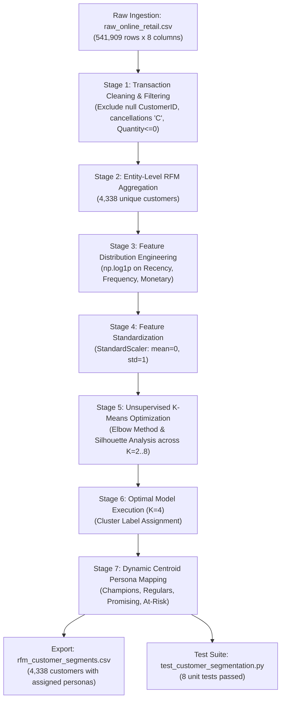

# Architecture Specification: Foundational Analytics — Task 2: Customer Segmentation

## System Architecture: Behavioral RFM Modeling & Unsupervised K-Means Clustering

**Document ID:** `ARCH-PRJ-02`  
**Track:** Data Analytics  
**Portfolio Scope:** Data Analytics Portfolio (`Business-Analytics-Portfolio`)  
**Target Module:** `projects/02_Customer_Segmentation/`  
**Candidate:** `Dhruv Goyal` *(Template document — replace prior to submission)*  
**Date:** October 2026  
**Status:** `Verified / Testing Complete`  

---

## 1. System Overview & Architectural Objectives

The Customer Segmentation subsystem transforms unorganized e-commerce transactional logs into discrete, statistically validated customer behavioral segments. The system enables CRM and marketing teams to automate targeted retention campaigns, prevent churn, and optimize customer lifetime value (CLV).

### Core Architectural Principles:
1. **Entity-Level Granularity:** Aggregates order-level rows into distinct customer entities indexed by unique `CustomerID`.
2. **Distribution Normalization:** Handles extreme positive right-skewness using non-linear log transformations prior to distance-based metric calculations.
3. **Rigorous Unsupervised Validation:** Combines the Elbow Method (SSE minimization) and Silhouette Analysis (cluster cohesion/separation) to avoid arbitrary cluster selection.
4. **Reproducible Pipeline Design:** Decouples ingestion, transformation, modeling, profiling, and export into deterministic, unit-tested stages.

---

## 2. Pipeline Decomposition & Data Flow

---

## 3. Data Dictionary & Transformation Specifications

| Entity Level | Field Name | Raw Type | Target Analytical Type | Definition & Mathematical Formulation |
|:---|:---|:---|:---|:---|
| **Transaction** | `InvoiceNo` | `object` | `VARCHAR(20)` | Unique 6-digit invoice identifier; `'C'` prefix denotes cancellation. |
| **Transaction** | `CustomerID` | `float64` | `VARCHAR(20)` | Unique customer key; unassigned rows dropped. |
| **Transaction** | `InvoiceDate` | `object` | `TIMESTAMP` | Timestamp of sale; formatted to datetime. |
| **Transaction** | `Quantity` | `int64` | `INT` | Units purchased; filtered for $\text{Quantity} > 0$. |
| **Transaction** | `UnitPrice` | `float64` | `FLOAT` | Unit price in GBP (£); filtered for $\text{UnitPrice} > 0$. |
| **Customer** | `Recency` | N/A (Engineered) | `INT` | Days elapsed: $\text{Date}_{\text{ref}} - \max(\text{InvoiceDate}_i)$. |
| **Customer** | `Frequency` | N/A (Engineered) | `INT` | Distinct invoices: $\text{CountDistinct}(\text{InvoiceNo}_i)$. |
| **Customer** | `Monetary` | N/A (Engineered) | `FLOAT` | Gross customer spend: $\sum (\text{Quantity} \times \text{UnitPrice})$. |
| **Customer** | `Avg_Order_Value` | N/A (Engineered) | `FLOAT` | Monetary divided by Frequency. |
| **Customer** | `Cluster` | N/A (Model) | `INT` | K-Means assigned cluster index ($0, 1, 2, 3$). |
| **Customer** | `Persona` | N/A (Business) | `VARCHAR(50)` | Actionable behavioral segment label. |

---

## 4. Modeling & Clustering Subsystem

### 4.1 Feature Transformation Pipeline
1. **Log Transformation:**
   $$R_{\text{log}} = \log(1 + R), \quad F_{\text{log}} = \log(1 + F), \quad M_{\text{log}} = \log(1 + M)$$
2. **Z-Score Normalization:**
   $$z = \frac{x_{\text{log}} - \mu}{\sigma}$$

### 4.2 K-Means Objective Function
$$\min \sum_{k=1}^K \sum_{x \in C_k} \|x - \mu_k\|^2$$
- $K=4$ selected based on:
  - Inertia elbow inflection at 3,938.51 (down from 6,481 at $K=2$ and 4,868 at $K=3$).
  - Silhouette local peak of **0.3371** (cohesion vs. separation trade-off).

---

## 5. Automated Testing & Quality Assurance Harness

The verification suite (`test_customer_segmentation.py`) implements 8 acceptance tests executed via Python `unittest`:

| Test Case | Verification Objective |
|:---|:---|
| `test_01_datasets_exist` | Confirms raw and segmented dataset files exist on disk and exceed 50 KB. |
| `test_02_rfm_customer_count` | Asserts exactly 4,338 customers are segmented with 100% unique primary keys. |
| `test_03_rfm_schema_and_zero_nulls` | Asserts all required schema columns exist and contain zero null values. |
| `test_04_rfm_value_bounds` | Validates positive physical domain boundaries ($R>0, F\ge 1, M>0, AOV>0$). |
| `test_05_cluster_optimization_metrics` | Validates monotonic decreasing SSE across $K=2..8$ and silhouette scores bounded in $[-1, 1]$. |
| `test_06_persona_coverage_and_distribution` | Validates all 4 personas exist with $>500$ members each (balanced clustering). |
| `test_07_revenue_reconciliation` | Reconciles segment monetary sums with overall portfolio revenue (£8.91M). |
| `test_08_artifacts_generated` | Asserts all 4 figures and 4 summary tables exist on disk. |
