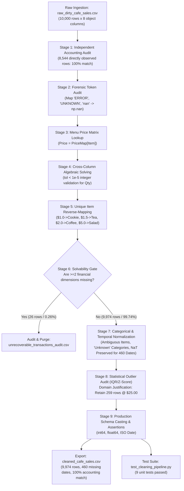

# Architecture Specification: Foundational Analytics — Task 3: Cleaning Data

## System Architecture: Cafe Sales Deterministic Data Cleaning & Integrity Pipeline

**Document ID:** `ARCH-PRJ-03`  
**Track:** Data Analytics  
**Portfolio Scope:** Data Analytics Portfolio (`Business-Analytics-Portfolio`)  
**Target Module:** `projects/03_Data_Cleaning_Pipeline/`  
**Candidate:** `Dhruv Goyal` *(Template document — replace prior to submission)*  
**Date:** October 2026  
**Status:** `Verified / Quality Gate Passed`  

---

## 1. System Overview & Architectural Objectives

The Cafe Sales Cleaning Pipeline is designed as a **deterministic, arithmetically constrained data engineering workflow**. Its core objective is to convert a highly corrupted transactional log (10,000 raw rows containing placeholder tokens, invalid dtypes, and unstandardized categories) into a production-grade analytical dataset suitable for relational warehousing and BI reporting.

### Core Architectural Principles:
1. **Arithmetic Integrity over Heuristics:** In transactional finance, $\text{Total} \equiv \text{Quantity} \times \text{Price}$. Imputing missing values with statistical averages creates mathematical contradictions. Domain constraints must resolve unknowns wherever possible.
2. **Defensible Purge Strategy:** Records are purged *only* when the mathematical degrees of freedom make recovery impossible ($1$ equation, $2$ unknowns).
3. **No Synthetic Date Imputation:** Missing or unparseable dates are preserved as `NaT` in memory and blank in CSV exports; median date imputation is strictly avoided to prevent fabricating historical records.
4. **Tolerance-Bounded Integer Reconstruction:** Quantity reconstruction requires $\text{abs}(\text{ratio} - \text{round}(\text{ratio})) < 10^{-5}$ and non-zero positive denominators; fractional ratios are rejected as unresolved.
5. **Non-Tautological Verification:** Accounting identities are verified on directly observed raw records first, proving the underlying generative model before applying algebraic solving.

---

## 2. Pipeline Flow & Component Decomposition

---

## 3. Data Dictionary & Transformation Specifications

| Field Name | Raw Format | Target Storage Type | Null Handling Strategy | Transformation Logic |
|:---|:---|:---|:---|:---|
| `Transaction ID` | `object` (string) | `object` / `VARCHAR(20)` | None (0 nulls in raw) | Validated 100% uniqueness as primary key. |
| `Item` | `object` (string) | `object` / `VARCHAR(30)` | Reverse lookup + Category tier | Reverse-mapped from unique prices (\$1.00, \$1.50, \$2.00, \$5.00); ambiguous tiers labeled `'Unknown ($3.0 Item)'` or `'Unknown ($4.0 Item)'`. |
| `Quantity` | `object` (string) | `int64` | Algebraic back-calculation | Calculated as $\text{Total Spent} / \text{Price Per Unit}$ ($\text{tol} < 10^{-5}$). Cast to integer. |
| `Price Per Unit` | `object` (string) | `float64` (2 decimals) | Menu dictionary + back-calc | Looked up from canonical menu table. For unlisted items, computed as $\text{Total Spent} / \text{Quantity}$. |
| `Total Spent` | `object` (string) | `float64` (2 decimals) | Forward calculation | Computed as $\text{Quantity} \times \text{Price Per Unit}$. Formally verified. |
| `Payment Method` | `object` (string) | `object` / `VARCHAR(20)` | Explicit `'Unknown'` category | Whitespace stripped, title-cased. Missing values assigned to `'Unknown'` to avoid mode bias. |
| `Location` | `object` (string) | `object` / `VARCHAR(20)` | Explicit `'Unknown'` category | Whitespace stripped, normalized to `'In-store'`, `'Takeaway'`, or `'Unknown'`. |
| `Transaction Date` | `object` (string) | `datetime64[ns]` / ISO string | Preserved as missing (`NaT`/blank) | Parsed to datetime; 460 unparseable strings preserved as `NaT` in memory and blank in CSV. No synthetic median date imputation. |

---

## 4. Automated Verification & Testing Harness

The verification suite (`test_cleaning_pipeline.py`) implements 9 rigorous acceptance tests executed on clean test runner:

| Test Case | Method | Assertion Checked |
|:---|:---|:---|
| `test_01_raw_dataset_immutability` | File System & Hash | Raw dataset dimensions unchanged at 10,000 rows × 8 columns. |
| `test_02_row_reconciliation` | Shape Audit | Exactly 10,000 raw rows = 9,974 clean rows + 26 purged in audit table. |
| `test_03_quantity_reconstruction_unit_logic` | Unit Math Tests | Validates exact integer ratio, float drift $<10^{-5}$, fractional ratio rejection, zero denominator rejection, negative rejection, missing input rejection. |
| `test_04_clean_dataset_quantities_positive_integers` | Domain & Schema | Assert Quantity is integer dtype and subset of $\{1, 2, 3, 4, 5\}$. |
| `test_05_date_handling_and_preservation` | Null & Temporal Audit | Exactly 460 dates preserved as missing/NaT; all 9,514 valid dates belong to 2023. |
| `test_06_non_tautological_accounting_identity` | Vectorized Identity | Tests 8,544 directly observed rows for 100.00% match, then checks clean table internal arithmetic consistency. |
| `test_07_no_unresolved_placeholder_tokens` | Token Match | Assert zero instances of `['ERROR', 'nan', 'NaN', 'None', '?']`. |
| `test_08_unique_transaction_ids` | Primary Key Uniqueness | Assert `clean_df['Transaction ID'].nunique() == len(clean_df)`. |
| `test_09_artifacts_generated` | Deliverable Check | Verify all 3 figures and 6 summary tables exist on disk and exceed minimum byte sizes. |
