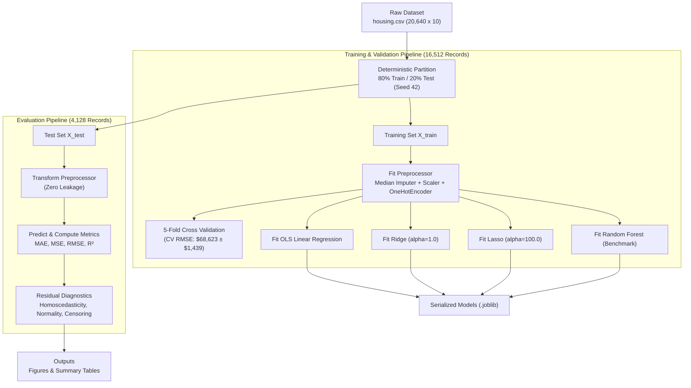

# Technical Architecture Document: House Price Prediction Engine

**Task:** Project 05 (House Price Prediction) — Predicting House Prices with Linear Regression (Task #5 in Master Roadmap)  
**System Name:** California Real Estate Econometric Modeling & Automated Valuation Pipeline  
**Portfolio Scope:** Data Analytics Portfolio (`Business-Analytics-Portfolio`)  
**Track:** Data Analytics  
**Date:** October 2026  
**Status:** `Testing Complete`

---

## 1. System Architecture Overview

The House Price Prediction Engine provides an automated, econometrically disciplined valuation pipeline that ingests continuous and categorical census block group attributes, enforces strict data leakage prevention via `ColumnTransformer` encapsulation, and outputs property price forecasts, standardized beta impacts, and residual diagnostics.

```
+-----------------------------------------------------------------------------+
|                          1. INGESTION & AUDIT LAYER                         |
|  - Raw Ingestion: housing.csv (20,640 census block groups x 10 features)    |
|  - Provenance: StatLib / 1990 U.S. Census Bureau (Pace & Barry, 1997)       |
|  - Integrity: SHA-256 Checksum Verified, 207 Nulls in total_bedrooms (1.0%) |
+-----------------------------------------------------------------------------+
                                       |
                                       v
+-----------------------------------------------------------------------------+
|                     2. LEAKAGE-FREE PARTITIONING & PIPELINE                 |
|  - Split: 80/20 Train/Test Split (random_state=42)                          |
|  - Train Set: 16,512 block groups (80.0%)                                   |
|  - Test Set: 4,128 block groups (20.0%)                                     |
|  - Preprocessor: ColumnTransformer                                          |
|      * Numeric: SimpleImputer(median) -> StandardScaler                     |
|      * Categorical: OneHotEncoder(drop='first') -> 4 Dummies (Ref: <1H)     |
|  - Guarantee: Zero out-of-fold parameter leakage during training and CV     |
|  - Spatial Caveat: Random splitting does not isolate spatial autocorrelation|
+-----------------------------------------------------------------------------+
                                       |
                                       v
+-----------------------------------------------------------------------------+
|                     3. STATISTICAL MODELING SUBSYSTEM                       |
|  Model 0: DummyRegressor(strategy='mean')                                   |
|    - Naive baseline (predicts training mean $206,856; RMSE: $114,486, R²: -0)|
|  Model 1: LinearRegression() [Primary Educational Model]                    |
|    - Closed-form normal equation: beta = (X^T X)^(-1) X^T y                 |
|  Model 2: Ridge(alpha=1.0)                                                  |
|    - L2 regularized regression: beta = (X^T X + alpha I)^(-1) X^T y         |
|  Model 3: Lasso(alpha=100.0)                                                |
|    - L1 regularized coordinate descent for sparse feature weighting         |
|  Model 4: RandomForestRegressor(n_estimators=100, max_depth=16)             |
|    - Non-linear spatial comparison benchmark (RMSE: $49,324, R²: 0.8143)    |
+-----------------------------------------------------------------------------+
                                       |
                                       v
+-----------------------------------------------------------------------------+
|                     4. EVALUATION & DIAGNOSTICS LAYER                       |
|  - Econometric Metrics: MAE, MSE, RMSE, R² Score                            |
|  - Cross-Validation: 5-Fold CV on training split (Mean +/- Std)             |
|  - Residual Diagnostics: Heteroscedasticity scatter, Q-Q Plot, Censoring    |
|  - Coefficient Extraction: Standardized conditional beta weights & intercept|
+-----------------------------------------------------------------------------+
                                       |
                                       v
+-----------------------------------------------------------------------------+
|                     5. ARTIFACT PERSISTENCE & SERVING LAYER                 |
|  - Serialization: joblib format for complete pipeline objects               |
|  - Outputs: 6 Publication figures (300 DPI) & 5 Summary CSV tables          |
|  - Verification: 12 Automated Unit Tests (test_house_price_prediction.py)   |
+-----------------------------------------------------------------------------+
```

---

## 2. Component Subsystem Details

### 2.1 Ingestion & Preprocessing Subsystem

The preprocessing subsystem uses `sklearn.compose.ColumnTransformer` to handle disparate column types in a single pass without data snooping:

```python
num_pipeline = Pipeline([
    ("imputer", SimpleImputer(strategy="median")),
    ("scaler", StandardScaler())
])

cat_pipeline = Pipeline([
    ("encoder", OneHotEncoder(drop="first", sparse_output=False, handle_unknown="ignore"))
])

preprocessor = ColumnTransformer([
    ("num", num_pipeline, numeric_features),
    ("cat", cat_pipeline, categorical_features)
])
```

- **Missing Data Handling:** `SimpleImputer` replaces the 207 missing values in `total_bedrooms` with the median of the training split (435.0 bedrooms).
- **Categorical Encoding:** `OneHotEncoder(drop='first')` converts `ocean_proximity` (5 levels) into 4 binary indicators:
  - Reference category (dropped): `<1H OCEAN`
  - Encoded columns: `INLAND`, `ISLAND`, `NEAR BAY`, `NEAR OCEAN`
  - This eliminates the dummy variable trap (exact linear dependency with the intercept column $\mathbf{1}$).

---

### 2.2 Mathematical Modeling Subsystem

#### Ordinary Least Squares (OLS)
The linear model seeks coefficients $\hat{\beta} \in \mathbb{R}^{12}$ and intercept $\hat{\beta}_0 \in \mathbb{R}$ minimizing the residual sum of squares:
$$\min_{\beta} \sum_{i=1}^{n} \left( y_i - \beta_0 - \sum_{j=1}^{p} X_{ij}\beta_j \right)^2$$
Because $X$ is standardized to mean zero and unit variance, $\hat{\beta}_0$ represents the expected price of a property with mean continuous features in the reference `<1H OCEAN` location ($219,899.78).

#### Regularization Formulations
- **Ridge ($L_2$ Regularization):** Adds penalty $\alpha \sum \beta_j^2$ with $\alpha = 1.0$. Shrinks weights toward zero proportionally.
- **Lasso ($L_1$ Regularization):** Adds penalty $\alpha \sum |\beta_j|$ with $\alpha = 100.0$. Promotes sparsity.
- **Empirical Behavior:** Because $N = 16,512 \gg P = 12$ ($N/P > 1,375$), sample covariance dominates the penalty matrix, resulting in virtually identical predictions between OLS, Ridge, and Lasso ($R^2 = 0.6254$ vs $0.6253$ vs $0.6252$).

---

## 3. Data Flow Diagram



---

## 4. Hardware & Runtime Benchmark

Measurements conducted on Windows 11 x64, Python 3.13.6:

| Stage | Operation | Execution Time | Memory Overhead |
|:---|:---|:---:|:---:|
| **Ingestion & Validation** | Load CSV and check schema | ~0.08 s | ~12 MB |
| **Preprocessing & Fitting** | Impute, scale, and dummy encode | ~0.12 s | ~18 MB |
| **Linear Regression Training** | OLS normal equation solve | ~0.02 s | ~2 MB |
| **5-Fold Cross Validation** | Linear regression CV loop | ~0.65 s | ~15 MB |
| **Regularized Models Training**| Ridge & Lasso fits + 5-fold CV | ~1.40 s | ~15 MB |
| **Random Forest Benchmark** | 100 trees, depth 16 (parallel) | ~4.20 s | ~140 MB |
| **Diagnostics & Plotting** | 6 figures @ 300 DPI + 5 tables | ~2.50 s | ~45 MB |
| **Total Pipeline Run** | End-to-end execution | **~9.0 s** | **< 200 MB** |

---

## 5. Interface Schema & Serialization

The production models are serialized to disk using `joblib` with standard scikit-learn pipeline interfaces:

```python
# Predict single observation
import joblib
import pandas as pd

pipeline = joblib.load("models/linear_regression_pipeline.joblib")

sample = pd.DataFrame([{
    "longitude": -122.23,
    "latitude": 37.88,
    "housing_median_age": 41.0,
    "total_rooms": 880.0,
    "total_bedrooms": 129.0,
    "population": 322.0,
    "households": 126.0,
    "median_income": 8.3252,
    "ocean_proximity": "NEAR BAY"
}])

predicted_price = pipeline.predict(sample)[0]
# Returns predicted price in USD ($)
```

### Artifact Manifest

| Artifact Path | Format | Size | Purpose |
|:---|:---:|:---:|:---|
| `models/linear_regression_pipeline.joblib` | Joblib | 4.5 KB | OLS Linear Regression pipeline |
| `models/ridge_pipeline.joblib` | Joblib | 4.4 KB | $L_2$ Ridge regression pipeline |
| `models/lasso_pipeline.joblib` | Joblib | 4.5 KB | $L_1$ Lasso regression pipeline |
| `models/random_forest_pipeline.joblib` | Joblib | 68.7 MB | 100-tree non-linear benchmark |
| `outputs/figures/fig1..fig6.png` | PNG (300 DPI) | ~3.1 MB total | Publication visualizations |
| `outputs/tables/*.csv` | CSV | ~4 KB total | Machine-readable metrics & coefficients |
