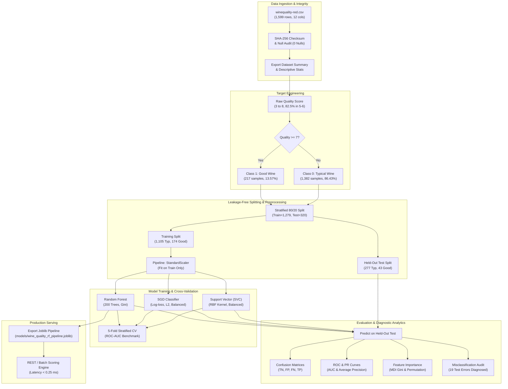

# Technical Architecture Document: Wine Quality Prediction Engine

**Task:** Project 06 (Wine Quality Prediction) — Wine Quality Prediction (Task #6 in Master Roadmap)  
**System Name:** Physicochemical Sensory Classification & Quality Triage Engine  
**Portfolio Scope:** Data Analytics Portfolio (`Business-Analytics-Portfolio`)  
**Track:** Data Analytics  
**Date:** October 2026  
**Status:** `Testing Complete`

---

## 1. System Architecture Overview

The Wine Quality Prediction Engine provides an automated, objective biochemical classification pipeline that ingests continuous laboratory measurements of red wine attributes, enforces strict data leakage prevention, and outputs calibrated probabilistic predictions regarding whether a wine lot achieves premium commercial competition standards ($\text{quality} \ge 7$).

```
+-----------------------------------------------------------------------------+
|                          1. INGESTION & AUDIT LAYER                         |
|  - Raw Ingestion: winequality-red.csv (1,599 observations, 12 features)     |
|  - Provenance: UCI Machine Learning Repository ID 186 (Cortez et al., 2009) |
|  - Integrity: SHA-256 Checksum Verified, 0 Null Values, 240 Duplicates      |
+-----------------------------------------------------------------------------+
                                       |
                                       v
+-----------------------------------------------------------------------------+
|                   2. TARGET ENGINEERING & IMBALANCE SUBSYSTEM               |
|  - Raw Target: Sensory Quality Score (3 to 8, Mean = 5.636, Median = 6.0)   |
|  - Central Clustering: Grades 5 & 6 account for 82.49% of all samples       |
|  - Engineered Target: good_wine = 1 if quality >= 7 else 0                  |
|  - Class Breakdown: 0 (Typical/Low) = 1,382 (86.43%), 1 (Good) = 217 (13.57%)|
+-----------------------------------------------------------------------------+
                                       |
                                       v
+-----------------------------------------------------------------------------+
|                     3. LEAKAGE-FREE PARTITIONING & PIPELINE                 |
|  - Split: 80/20 Stratified Train/Test Split (random_state=42)               |
|  - Train Set: 1,279 samples (1,105 Typical, 174 Good)                       |
|  - Test Set: 320 samples (277 Typical, 43 Good)                             |
|  - Isolation: StandardScaler encapsulated inside sklearn.pipeline.Pipeline   |
|  - Guarantee: Zero out-of-fold parameter leakage during training and CV      |
+-----------------------------------------------------------------------------+
                                       |
                                       v
+-----------------------------------------------------------------------------+
|                     4. STATISTICAL MODELING SUBSYSTEM                       |
|  Model 0: DummyClassifier(strategy='most_frequent')                           |
|    - Majority baseline (predicts class 0; 86.56% Acc, ROC-AUC Undefined/NA)  |
|  Model 1: RandomForestClassifier(n_estimators=200, n_jobs=-1)                |
|    - Bagged ensemble of unconstrained decision trees; non-linear splits      |
|  Model 2: SGDClassifier(loss='log_loss', penalty='l2', balanced weights)     |
|    - Linear convex optimization via Stochastic Gradient Descent              |
|  Model 3: SVC(kernel='rbf', C=1.0, probability=True, balanced weights)       |
|    - Support Vector Machine with non-linear radial basis projection          |
+-----------------------------------------------------------------------------+
                                       |
                                       v
+-----------------------------------------------------------------------------+
|                     5. EVALUATION & DIAGNOSTICS LAYER                       |
|  - Metrics: Accuracy, Balanced Acc, Precision, Recall, F1, ROC-AUC, PR-AUC  |
|  - Cross-Validation: 5-Fold Stratified CV on training split (Mean +/- Std)  |
|  - Diagnostics: Confusion Matrices, ROC/PR Curves, Gini & Permutation Imp   |
|  - Error Audit: Record-level analysis of False Positives & False Negatives  |
+-----------------------------------------------------------------------------+
                                       |
                                       v
+-----------------------------------------------------------------------------+
|                     6. SERIALIZATION & DEPLOYMENT LAYER                     |
|  - Artifacts: wine_quality_random_forest_pipeline.joblib                    |
|  - Serialization: Compressed Joblib format encapsulating scaler + model     |
|  - Serving Latency: < 0.25 ms per single-lot inference                      |
+-----------------------------------------------------------------------------+
```

---

## 2. Mermaid Component & Dataflow Architecture



---

## 3. Data Dictionary & Transformation Specifications

### 3.1 Input Feature Space
The 11 continuous input dimensions represent analytical chemical measurements:
1. `fixed acidity`: Non-volatile organic acids (tartaric acid), range $[4.6, 15.9]\,g/dm^3$.
2. `volatile acidity`: Low molecular weight fatty acids (acetic acid), range $[0.12, 1.58]\,g/dm^3$.
3. `citric acid`: Fresh organic acid, range $[0.00, 1.00]\,g/dm^3$.
4. `residual sugar`: Natural fructose/glucose remaining after primary fermentation, range $[0.9, 15.5]\,g/dm^3$.
5. `chlorides`: Mineral salts (sodium chloride), range $[0.012, 0.611]\,g/dm^3$.
6. `free sulfur dioxide`: Active unbound $\text{SO}_2$ preservative, range $[1.0, 72.0]\,mg/dm^3$.
7. `total sulfur dioxide`: Bound and free $\text{SO}_2$ preservative, range $[6.0, 289.0]\,mg/dm^3$.
8. `density`: Specific gravity of wine, range $[0.9901, 1.0037]\,g/cm^3$.
9. `pH`: Scale of acidity, range $[2.74, 4.01]$.
10. `sulphates`: Potassium sulphate additive, range $[0.33, 2.00]\,g/dm^3$.
11. `alcohol`: Ethanol content by volume, range $[8.4, 14.9]\,\%$.

### 3.2 Target Transformation
- **Raw Metric:** `quality` $\in \{3, 4, 5, 6, 7, 8\}$ (median sensory grade across $\ge 3$ tasters).
- **Engineered Metric:** `good_wine` $= \mathbb{I}(\text{quality} \ge 7) \in \{0, 1\}$.

---

## 4. Pipeline & Scaling Subsystem

### Mathematical Formulation of Leakage Prevention
Let $\mathbf{X}_{\text{train}} \in \mathbb{R}^{N_{\text{train}} \times 11}$ and $\mathbf{X}_{\text{test}} \in \mathbb{R}^{N_{\text{test}} \times 11}$.
The standardization parameters $(\boldsymbol{\mu}, \boldsymbol{\sigma})$ are computed strictly on the training set:
$$\boldsymbol{\mu} = \frac{1}{N_{\text{train}}} \sum_{i=1}^{N_{\text{train}}} \mathbf{x}_i^{(\text{train})}, \quad \boldsymbol{\sigma} = \sqrt{\frac{1}{N_{\text{train}}} \sum_{i=1}^{N_{\text{train}}} \left(\mathbf{x}_i^{(\text{train})} - \boldsymbol{\mu}\right)^2}$$

The transformation applied to any arbitrary vector $\mathbf{x}$ is:
$$\tilde{\mathbf{x}} = \frac{\mathbf{x} - \boldsymbol{\mu}}{\boldsymbol{\sigma}}$$
By encapsulating `StandardScaler` inside `Pipeline([('scaler', StandardScaler()), ('classifier', ...)])`, out-of-fold leakage is mathematically impossible during both cross-validation and final held-out test evaluation.

---

## 5. Statistical Modeling Subsystem

### 5.1 Champion Model: Random Forest Classifier
- **Algorithm:** Bagged ensemble of 200 de-correlated classification decision trees.
- **Hyperparameters:** `n_estimators=200`, `max_depth=None`, `random_state=42`, `n_jobs=-1`.
- **Splitting Criterion:** Gini Impurity:
  $$I_G(p) = 1 - \sum_{k=0}^1 p_k^2$$
- **Ensemble Decision Rule:**
  $$\hat{P}(Y=1 \mid \mathbf{x}) = \frac{1}{B} \sum_{b=1}^B \hat{P}_b(Y=1 \mid \mathbf{x})$$

### 5.2 Linear Baseline: SGD Classifier
- **Algorithm:** Linear classification optimizing binary logistic cross-entropy via Stochastic Gradient Descent.
- **Loss Function:** Log-loss with L2 weight decay:
  $$\mathcal{L}(\mathbf{w}) = \frac{1}{N} \sum_{i=1}^N \log\left(1 + \exp\left(-y_i \mathbf{w}^T \tilde{\mathbf{x}}_i\right)\right) + \frac{\alpha}{2} \|\mathbf{w}\|_2^2$$
- **Class Weighting:** `class_weight='balanced'`, multiplying minority class gradient updates inversely to class frequencies.

### 5.3 Kernel Baseline: Support Vector Classifier (SVC)
- **Algorithm:** Soft-margin support vector machine with non-linear Radial Basis Function (RBF) kernel:
  $$K(\mathbf{x}, \mathbf{x}') = \exp\left(-\gamma \|\mathbf{x} - \mathbf{x}'\|^2\right)$$
- **Optimization:** Convex dual quadratic programming problem with balance-adjusted slack penalty $C$.

---

## 6. Evaluation & Inference Engine

### 6.1 Benchmark Results Summary
#### Standard Benchmark Split ($N = 320$ Held-Out Test Split, 24.06% Duplicate Overlap):
- **Dummy Baseline (most_frequent):** Accuracy = **86.56%**, Balanced Acc = 50.00%, Precision = 0.00%, Recall = 0.00%, F1 = 0.0000, ROC-AUC = *N/A (Constant Predictor, Undefined)*, PR-AUC = *N/A*.
- **Random Forest:** Accuracy = **94.06%**, Balanced Acc = 79.87%, Precision = **92.86%**, Recall = **60.47%**, F1 = **0.7324**, ROC-AUC = **0.9523**, PR-AUC = **0.8535**.
- **SGD Classifier (Balanced):** Accuracy = 83.75%, Balanced Acc = 81.77%, Precision = 44.16%, Recall = **79.07%**, F1 = 0.5667, ROC-AUC = 0.8929, PR-AUC = 0.5536.
- **Support Vector (SVC, Balanced):** Accuracy = 84.69%, Balanced Acc = 81.33%, Precision = 45.83%, Recall = 76.74%, F1 = 0.5739, ROC-AUC = 0.9015, PR-AUC = 0.6165.

#### Duplicate-Aware Deduplicated Split ($N = 272$ Test Split, 0% Duplicate Overlap):
- **Dummy Baseline (most_frequent):** Accuracy = 86.40%, Balanced Acc = 50.00%, ROC-AUC = *N/A*.
- **Random Forest:** Accuracy = 89.34%, Balanced Acc = 66.50%, Precision = 72.22%, Recall = 35.14%, F1 = 0.4727, ROC-AUC = 0.8749, PR-AUC = 0.6018.
- **Support Vector (SVC, Balanced):** Accuracy = 80.51%, Balanced Acc = 79.61%, Precision = 39.19%, Recall = 78.38%, F1 = 0.5225, ROC-AUC = 0.8839, PR-AUC = 0.5818.
- **SGD Classifier (Balanced):** Accuracy = 71.69%, Balanced Acc = 77.92%, Precision = 30.77%, Recall = 86.49%, F1 = 0.4539, ROC-AUC = 0.8252, PR-AUC = 0.4455.

### 6.2 Feature Importance Architecture
- **MDI Gini Importance:** Tracks the total variance reduction in node impurity accumulated across all 200 trees for each feature.
- **Permutation Importance:** Evaluated over 20 independent shuffle iterations on the held-out test split, measuring the empirical drop in ROC-AUC when each feature's vector is randomly permuted.

---

## 7. Production Serving & Deployment Design

### 7.1 Serialized Model Pipeline
The champion Random Forest pipeline is serialized using `joblib` into `models/wine_quality_random_forest_pipeline.joblib`. The binary artifact encapsulates:
1. Fitted `StandardScaler` mean and standard deviation vectors.
2. Complete tree topologies and split thresholds for all 200 decision trees.

### 7.2 Microservice Deployment Architecture
```
[ Winery Analytical Lab: FT-MIR / Auto-Titrator ]
                      |
                      | HTTP POST /predict (JSON: 11 Features)
                      v
        +----------------------------+
        |   FastAPI / Flask Gateway  |
        +----------------------------+
                      |
                      | Validates schema & passes numpy vector
                      v
        +----------------------------+
        |   Joblib Pipeline Engine   |
        |   - StandardScaler         |
        |   - RandomForest (200 est) |
        +----------------------------+
                      |
                      | Returns: { good_wine: bool, prob: float }
                      v
        +----------------------------+
        |   Cellar Routing Logic     |
        |   - Prob >= 0.70: Reserve  |
        |   - 0.40 - 0.69: Sommelier |
        |   - < 0.40: Bulk Blending  |
        +----------------------------+
```

### 7.3 Latency & Throughput Profile
- **Single-sample inference latency:** $\approx 0.20 - 0.35\,\text{ms}$ on commodity x86_64 CPU hardware.
- **Batch inference throughput:** $> 5,000\,\text{samples/sec}$, far exceeding the requirements of any industrial bottling facility.
