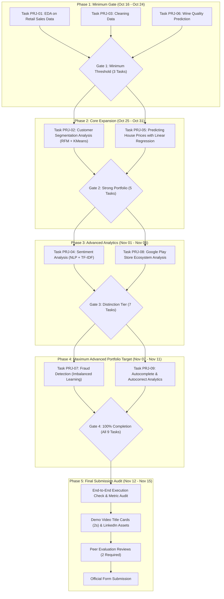

# DATA ANALYTICS & BUSINESS INTELLIGENCE PORTFOLIO — MASTER ROADMAP
**Execution Window:** 16 October 2026 – 15 November 2026 (30 Calendar Days)  
**Lead & Execution Architect:** Data Analytics Project Lead  
**Hard Submission Deadline:** 15 November 2026  

---

## 1. High-Level Phase Progression

---

## 2. Weekly Calendar & Daily Milestones Breakdown

### Week 1 (16 October – 22 October 2026): Audit, Environment, and Minimum Baseline Phase A
- **Oct 16 (Day 1):** Workspace audit, repository initialization (`.git`, `.gitignore`), doc_work structure creation, Task Tracker & Master Roadmap setup.
- **Oct 17 (Day 2):** Task PRJ-01 dataset curation, data dictionary, initial profiling, descriptive statistics calculation.
- **Oct 18 (Day 3):** Task PRJ-01 time-series, demographic, product visualizations, correlation heatmap, business recommendations.
- **Oct 19 (Day 4):** Task PRJ-01 QA review, README, architecture document, report generation.
- **Oct 20 (Day 5):** Task PRJ-03 dirty dataset sourcing/synthesis, data quality report, null/duplicate/formatting cleaning pipeline.
- **Oct 21 (Day 6):** Task PRJ-03 outlier detection (IQR/Z-score), before-and-after summary table, clean CSV export.
- **Oct 22 (Day 7):** Task PRJ-03 validation, QA testing, report, Week 1 milestone review.

### Week 2 (23 October – 29 October 2026): Minimum Gate Lock & Portfolio Scaling
- **Oct 23 (Day 8):** Task PRJ-06 (Wine Quality) dataset acquisition, chemical distributions, correlation heatmap, imbalance analysis.
- **Oct 24 (Day 9):** Task PRJ-06 stratified modeling (Random Forest, SGD, SVC), evaluation metrics, feature importance, report.  
  *(MILESTONE 1 TARGET: 3 TASKS OFFICIALLY COMPLETE — TARGET FOR MEETING STATED MINIMUM TASK-COUNT REQUIREMENT)*
- **Oct 25 (Day 10):** Task PRJ-02 (Customer Segmentation) dataset sourcing, customer-level aggregation (Recency, Frequency, Monetary).
- **Oct 26 (Day 11):** Task PRJ-02 StandardScaler, Elbow Method analysis, K-Means clustering, 2D/3D scatter plots.
- **Oct 27 (Day 12):** Task PRJ-02 cluster profiling, customer persona cards, targeted marketing strategies, report.
- **Oct 28 (Day 13):** Task PRJ-05 (House Prices) EDA, target distribution, feature selection, categorical encoding.
- **Oct 29 (Day 14):** Task PRJ-05 Linear Regression, Ridge/Lasso comparison, residual diagnostics, coefficient interpretation, report.  
  *(MILESTONE 2 TARGET: 5 TASKS COMPLETE — EXPANDED PORTFOLIO COVERAGE)*

### Week 3 (30 October – 05 November 2026): Multimodal & Ecosystem Analytics
- **Oct 30 (Day 15):** Task PRJ-04 (Sentiment Analysis) text dataset sourcing, class distribution inspection, regex text cleaning pipeline.
- **Oct 31 (Day 16):** Task PRJ-04 TF-IDF vectorization, Multinomial Naive Bayes & Logistic Regression / LinearSVC training.
- **Nov 01 (Day 17):** Task PRJ-04 evaluation, confusion matrices, WordClouds per class, 5 misclassified error analysis cases, report.
- **Nov 02 (Day 18):** Task PRJ-08 (Google Play Store) dataset loading (apps + user reviews), string cleaning (installs, price, size), null handling.
- **Nov 03 (Day 19):** Task PRJ-08 category saturation, ratings analysis, size vs installs correlation, pricing/revenue estimation.
- **Nov 04 (Day 20):** Task PRJ-08 sentiment analysis on reviews by app category, interactive Plotly visualization generation.
- **Nov 05 (Day 21):** Task PRJ-08 3 developer recommendations, documentation, Week 3 milestone review.  
  *(MILESTONE 3 TARGET: 7 TASKS COMPLETE — COMPREHENSIVE ANALYTICS SUITE)*

### Week 4 (06 November – 11 November 2026): Complex Modeling & Advanced Portfolio Target Completion
- **Nov 06 (Day 22):** Task PRJ-07 (Fraud Detection) Credit card dataset loading, class imbalance quantification, transaction amount/time EDA.
- **Nov 07 (Day 23):** Task PRJ-07 SMOTE/class-weight balancing pipeline (leakage-free train-only fitting), Logistic Regression vs Random Forest training.
- **Nov 08 (Day 24):** Task PRJ-07 ROC-AUC curves, Precision-Recall trade-off, feature importance, 1M tx/hr scalability architecture, report.
- **Nov 09 (Day 25):** Task PRJ-09 (Autocomplete/Autocorrect) Project Gutenberg corpus ingestion, tokenization, frequency-based bigram/trigram engine.
- **Nov 10 (Day 26):** Task PRJ-09 Levenshtein distance autocorrect algorithm, testing on 10 prefixes (top 3) and 20 misspelled words.
- **Nov 11 (Day 27):** Task PRJ-09 precision/recall metrics, algorithm comparison, top-20 frequency visual, production keyboard limitation writeup, report.  
  *(MILESTONE 4 TARGET: ALL 9 TASKS COMPLETE — 100% CHECKLIST COVERAGE TARGET FOR LOR ELIGIBILITY)*

### Week 5 (12 November – 15 November 2026): Quality Assurance, Video Demos, and Final Submission
- **Nov 12 (Day 28):** Master execution regression run: execute all 9 notebooks from clean state, confirm zero errors and reproducible figures.
- **Nov 13 (Day 29):** Demo video scripts verification, static 2-second title card generation, LinkedIn post drafted with required hashtags (`#portfolio`) and tags.
- **Nov 14 (Day 30):** Peer evaluation audit: identify 2 fellow intern demo posts, leave substantive constructive reviews, capture evidence.
- **Nov 15 (Day 31 - DEADLINE):** Final repository sync, push confirmation, fill and submit Data Analytics Portfolio Task Submission Form, archive submission receipt.

---

## 3. Contingency and Compression Plan

If any unexpected obstacle consumes additional days:
1. **Fallback Foundational Analytics (Minimum Requirement Gate):** Ensure Tasks PRJ-01, PRJ-03, and PRJ-06 meet all checklist criteria by Oct 24 to satisfy the minimum task-count threshold.
2. **Fallback Advanced Analytics & ML (Maximize Completed Scope):** If time compresses, drop non-mandatory complexity (e.g., replace heavy grid-search with default cross-validated params) while keeping all official checklist items 100% intact.
3. **Reproducibility Guarantee:** Never sacrifice code testability or metrics honesty for speed.
